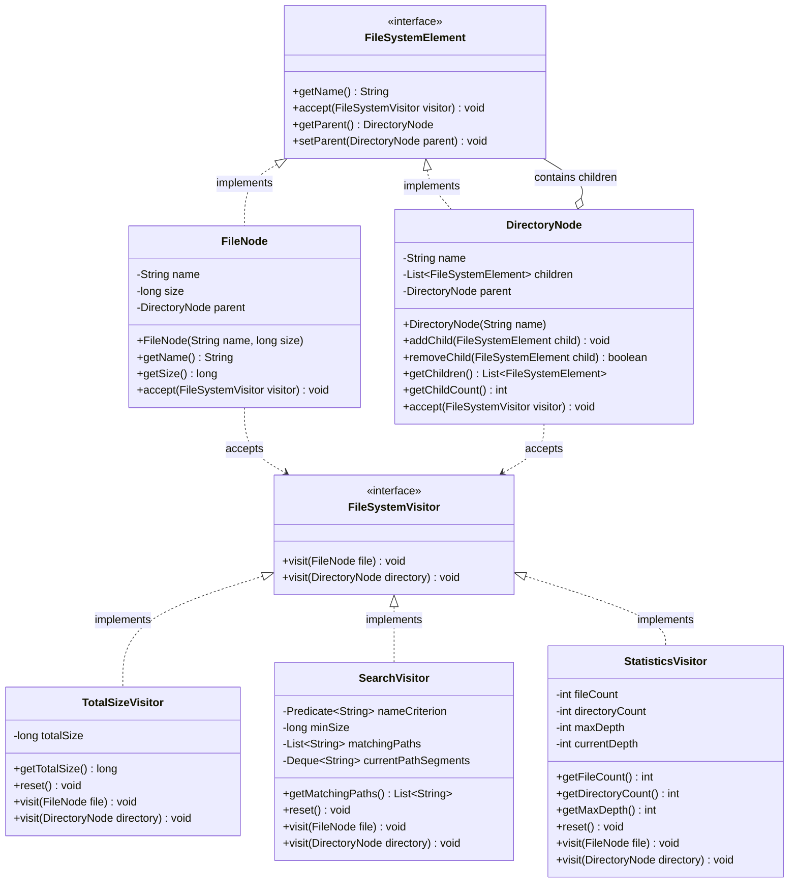

# ASTANA IT UNIVERSITY
### Faculty of Computer Science | Department of Software Engineering
**Course:** ShP-2216 | Software Design Patterns  
**Assignment 06:** Visitor Pattern — Advanced File System  
**Student:** Ramazan Aljanov  
**GitHub Repository:** [https://github.com/RamazanAljaanov/Assignment-6-SDP-Visiter-Pattern](https://github.com/RamazanAljaanov/Assignment-6-SDP-Visiter-Pattern)  

---

## 1. Purpose and Design Choices

### Purpose
The primary objective of this project is to implement an in-memory hierarchical file system using the **Visitor behavioral pattern** with **Double Dispatch** in Java 17. The system decouples the hierarchical object model (`FileNode`, `DirectoryNode`) from operations executed over it, allowing new behaviors to be added without modifying the composite structure.

### Core Design Decisions
1. **Object Structure & Double Dispatch:** 
   * A common interface `FileSystemElement` defines `void accept(FileSystemVisitor visitor)`.
   * Concrete elements `FileNode` and `DirectoryNode` override `accept()` to invoke `visitor.visit(this)`, passing their exact compile-time type (`this`) without using `instanceof` or runtime type inspection.
2. **Strict Tree Integrity Enforcement (R6):**
   * Negative file sizes and blank names are rejected at instantiation (`IllegalArgumentException`).
   * Duplicate sibling names within the same directory are rejected (`IllegalArgumentException`).
   * Multiple parent ownership is prohibited; nodes can belong to only one directory (`IllegalStateException`).
   * Cycles are prevented: during `DirectoryNode.addChild()`, the tree walks up the ancestor hierarchy using reference equality (`==`) to ensure a directory cannot be added inside itself or its descendants (`IllegalStateException`).
3. **Traversal Ownership (R7):**
   * **The Visitors own traversal.** Inside `visit(DirectoryNode)`, each visitor iterates over `directory.getChildren()` and calls `child.accept(this)`.
   * *Rationale:* This keeps `DirectoryNode` a pure, passive domain model. It gives each visitor full control over its state (e.g., maintaining a path stack in `SearchVisitor` or tracking current recursion depth in `StatisticsVisitor`).
4. **Controlled State & Reusability:**
   * Every visitor implements a `reset()` method to clear accumulated state, guaranteeing idempotency and preventing state leakage across repeated executions.

---

## 2. UML Class Diagram



---

## 3. Five Clean Code Justifications

1. **Meaningful Naming (`TotalSizeVisitor`, `DirectoryNode.addChild`):**
   * *Justification:* Identifiers clearly state their domain intent and operational semantics, making code self-explanatory without redundant comments.
2. **Single Responsibility Principle (`FileNode`, `SearchVisitor`):**
   * *Justification:* `FileNode` is solely responsible for encapsulating file metadata, whereas `SearchVisitor` isolates the filtering logic and deterministic path assembly.
3. **Small Methods (`DirectoryNode.addChild`, `SearchVisitor.buildCurrentPath`):**
   * *Justification:* Methods are concise, focused on one task, and exhibit low cognitive complexity and clear exception boundaries.
4. **Encapsulation (`DirectoryNode.getChildren`):**
   * *Justification:* Exposing `Collections.unmodifiableList(children)` guarantees that client code cannot bypass directory invariants or modify child collections directly.
5. **Elimination of Type-Checking Chains (Double Dispatch in `accept()`):**
   * *Justification:* Dynamic polymorphism replaces error-prone `if-instanceof` branching chains, upholding the Open-Closed Principle and improving extensibility.

---

## 4. Traversal and Extension Trade-Offs

### Traversal Ownership Trade-Off
* **Chosen Approach (Visitor-Driven Traversal):** The traversal logic is placed in `visit(DirectoryNode)`. 
  * *Advantage:* Enables custom traversal strategies per visitor (e.g. depth-first path tracking vs simple accumulation) while keeping domain classes free of traversal-specific state.
  * *Alternative (Composite / Internal Traversal):* If `DirectoryNode.accept()` traversed its own children, visitors could not easily maintain pre-visit and post-visit hooks (such as popping directories from the path stack in `SearchVisitor`).

### Extension Boundary Trade-Off (Visitor Pattern Nature)
* **Adding Operations (Visitors):** Highly flexible. Adding `StatisticsVisitor` (R8) required zero modifications to `FileNode`, `DirectoryNode`, or existing visitors, fully respecting the Open-Closed Principle (OCP).
* **Adding Element Types (Nodes):** Rigorous trade-off. Adding a new element type (such as `SymlinkNode`) breaks OCP across all visitors: it requires altering the `FileSystemVisitor` interface (`visit(SymlinkNode)`) and updating every existing visitor class (`TotalSizeVisitor`, `SearchVisitor`, `StatisticsVisitor`).

---

## 5. Automated Verification & Test Results

All tests are executed using **JUnit 5** via Maven command `mvn test` without IDE dependencies:
* **Test Class:** `kz.aitu.sdp.filesystem.FileSystemVisitorTest`
* **Test Results:** `Tests run: 8, Failures: 0, Errors: 0, Skipped: 0` (100% Passed)

| Check | Test Method Name | Verification Target | Status |
|:---:|:---|:---|:---:|
| **T1** | `testT1_doubleDispatchRouting` | Double dispatch correctly invokes overloaded `visit()` methods without `instanceof`. | PASSED |
| **T2** | `testT2_sizeAccumulationAcrossNestingLevels` | Accurate recursive byte summation across 3+ levels of nesting (2000 bytes). | PASSED |
| **T3** | `testT3_searchCombinesBothFilters` | Search accurately combines filename substring and minimum size threshold. | PASSED |
| **T4** | `testT4_searchProducesDeterministicRootRelativePaths` | Paths are root-relative, use `/`, and are strictly lexicographically sorted. | PASSED |
| **T5** | `testT5_statisticsVisitorAccuracy` | Accurately counts files, directories (including root), and maximum tree depth. | PASSED |
| **T6** | `testT6_emptyStructuresAndNoMatch` | Edge cases: empty directories, zero files, and empty search results return gracefully. | PASSED |
| **T7** | `testT7_repeatExecutionsDoNotLeakState` | Re-running visitors after `reset()` prevents state accumulation or duplication. | PASSED |
| **T8** | `testT8_treeIntegrityEnforcement` | Invariants enforced: negative size, duplicates, multi-parent, and cycles rejected. | PASSED |

---

## 6. Sample Program Execution Output

Executing `Main.java` via `mvn compile exec:java`:

```text
================================================================================
 ASTANA IT UNIVERSITY | ShP-2216 Software Design Patterns | Assignment 06
 Topic: Advanced File System with Visitor Pattern & Double Dispatch
================================================================================

[1] Constructing hierarchical file tree...
   Tree structure successfully created.

[2] Executing TotalSizeVisitor (R3):
   -> Total size of entire subtree: 38820 bytes (37.91 KB)

[3] Executing SearchVisitor (R4):
   Criterion: file name contains '.java' AND size >= 3000 bytes
   -> Deterministic root-relative results (lexicographically sorted):
      * src/main/java/Application.java
      * src/main/java/Service.java

[4] Executing StatisticsVisitor (R5, R8 - Added via OCP):
   -> Collected File System Statistics:
      * Total files:       9
      * Total directories: 9 (including root)
      * Maximum depth:     4 (root depth = 0)

[5] Demonstrating Tree Integrity Validations (R6):
   [OK] Negative size rejected: File size cannot be negative: -100
   [OK] Duplicate sibling rejected: Duplicate sibling name detected: 'README.md' already exists in directory 'sdp-project'
   [OK] Cycle rejected: Cycle detected: cannot add ancestor directory 'sdp-project' as a child of 'docs'

================================================================================
 All demonstrations completed successfully with 100% invariant preservation.
================================================================================
```
